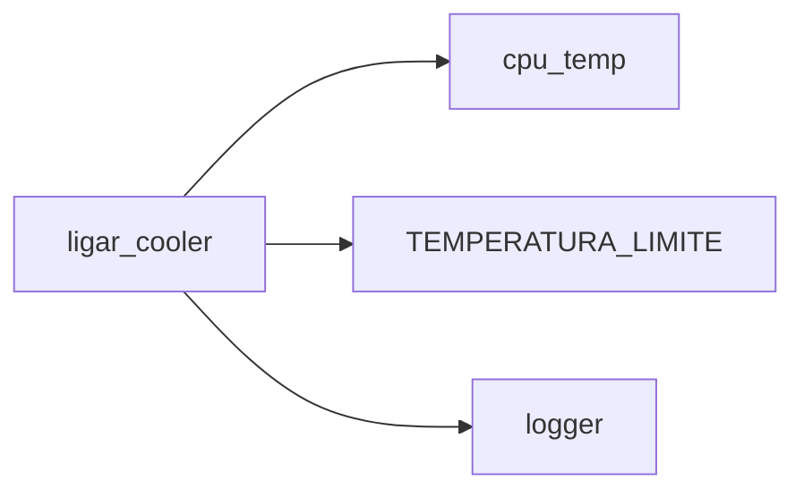

# Testabilidade em Python: dependências, acoplamento e decisões de design

Nesta série de duas lives, vamos discutir como as relações entre objetos e o acoplamento impactam diretamente a testabilidade e o design do código.

Na primeira live, essa, o foco é entender o problema: vamos conversar sobre dependências, relacionamentos entre objetos e como certas decisões de design tornam o código mais difícil de testar. Também veremos algumas técnicas para lidar com esse cenário, olhando tanto para o uso quanto para os testes desses relacionamentos.

Na segunda live, próximo encontro, avançamos para os dublês de teste, com foco em stub, spy e mock, entendendo quando (e por que) cada um faz sentido — sempre conectando essas escolhas às dependências do código.

Parte 1 — Introdução, problemática e técnicas (23/fev)
Parte 2 — Dublês de teste e sua relação direta com dependências (09/mar)

## :warning: Um aviso **importante** antes de começar

Essa live pode levar a discussões teóricas por diferentes correntes de pensamentos em programação. Principalmente em relação a técnicas.

Quero que pensemos em python como uma linguagem dinâmica em runtime, com suporte a tipagem gradual, multi-paradigma e também em uma corrente de pensamento [pós lineu](https://cs.brown.edu/~sk/Publications/Papers/Published/sk-teach-pl-post-linnaean/paper.pdf).

Ou seja, a gente vai tentar espremer a linguagem, sem pensar em técnicas específicas de uma corrente específica. O que quer dizer sem dogmatismo de OOP/Funcional/Tipagem estática/... Sem agradar livros de engenharia.

## Um outro aviso

Vamos usar [Pytest](https://docs.pytest.org/) como parte elementar dessa discução. Não pretendo me aprofundar nele. Alguns materiais sobre ele:

- [Pytest: Uma introdução - Live de Python #167](https://youtu.be/MjQCvJmc31A)
- [Pytest Fixtures - Live de Python #168](https://youtu.be/sidi9Z_IkLU)

Se quiser um básico sobre testes:

- [O mínimo que você deveria saber sobre testes unitários](https://youtu.be/pZvhZ-Lr-PE)
- [https://youtu.be/-8H2Pyxnoek](https://youtu.be/-8H2Pyxnoek)

Então... antes de tudo:

`pip install pytest`


## Um passo para trás: a problemática

> PS: A terminologia usada aqui segue a proposta de Gerard Meszaros no livro xUnit Test Patterns: Refactoring Test Code.

Todo teste tem "algo" que precisa ser testado. Por exemplo: Quando quero testar a função `xpto`, ela é o algo que será testado. A "coisa" em teste, costumamos chamar de [SUT (System Under Test)](http://xunitpatterns.com/SUT.html).

```python
def xpto():
    return 42
```

Para testarmos isso, existe um pequeno padrão. O AAA (Arrange-Act-Assert):

```python
def test_xpto():
    # Arrange
    expected_result = 24  # Falha proposital

    # Act
    result = xpto()

    # Assert
    assert result == expected_result
```

Onde:

- Arrange: Prepara o terreno e os valores para o teste poder ser executado
- Act: Efetivamente a chamada do SUT
- Assert: A comparação do resultado do SUT com o dado esperado


Esse é o cenário ideal, perfeito, *by the book* dos testes.


### Dependência / Composição / Acoplamento

Uma das coisas mais normais durante a escrita de código é que uma coisa dependa de outra para ser executada.

```mermaid
flowchart TD
   A -> B
```

Vamos pensar em um exemplo lúdico, mas que pode ser bastante desafiador ao pensar no isolamento do SUT.

Imagine que temos que ligar o cooler do nosso PC quando temperatura do processador for maior que `TEMPERATURA_LIMITE`:

```python
from logging import basicConfig, DEBUG, getLogger
import sys

basicConfig(stream=sys.stdout, level=DEBUG)

logger = getLogger(__name__)


TEMPERATURA_LIMITE = 40


def cpu_temp() -> int:
    """
    Função dummy para ler temperatura.

    Vamos usar o `psutil` em breve!

    >>> import psutil
    >>> psutil.sensors_temperatures()['coretemp'][0].current
    61
    """
    return 30


def ligar_cooler() -> bool:
    temperatura_atual = cpu_temp()

    if temperatura_atual >= TEMPERATURA_LIMITE:
        logger.info('Cooler ligado')
        return True

    logger.info('Cooler desligado')
    return False
```

Aqui vemos um caso clássico de um *mar* de dependências que ao primeiro momento parecem inofensivas:

1. A função `ligar_cooler` depende de `cpu_temp` para ser executada.
2. O corpo dela ainda depende do retorno de `cpu_temp` para decidir em qual *branch* de código vai entrar.
3. `TEMPERATURA_LIMITE` é uma constante que não conhecemos dentro do escopo
4. `logger` não muda a lógica de de resposta de `ligar_cooler`, mas pode gerar efeitos colaterais visíveis nos testes (stdout, arquivos de log), e testes podem precisar capturar ou ignorar isso.

Nos testes, dizemos que o SUT tem alguns [DOCs (Depended-On Component)](http://xunitpatterns.com/DOC.html).

Ou seja, para ser executada ela tem diversas dependências de coisas que não fazem parte do seu escopo e ela não tem nenhum conhecimento.

`ligar_cooler` é idiomaticamente simples, correta, fácil de ler. O problema aqui não é que não conseguimos testar. O problema é que o teste passa a depender de estado externo e perde determinismo.

Muitas coisas "interferem" no estado final do cooler.

O que esperaríamos que fosse um teste *AAA* simples, como:

```python
def test_ligar_cooler():
    expected_result = True
    result = ligar_cooler()
    assert expected_result == result
```

Se baseia em diversas premissas falsas:

- `TEMPERATURA_LIMITE` sempre será `40`;
- `cpu_temp` sempre retornará `30`.

Mas incrivelmente, "o teste passa" dessa forma. O fato de não conseguirmos cobrir 100% dele é somente um detalhe... Não dizem que 100% de cobertura é um mito?

Bom... Observações feitas, vamos começar a pensar um pouco sobre esse código e suas interações com coisas de fora da função.

### Acoplamento

Acoplamento é o grau de dependência entre diferentes partes do código. Quanto mais uma função ou módulo precisa conhecer detalhes de outro para funcionar, mais acoplados eles estão.

No nosso exemplo:



E todas essas coisas trabalham de forma coordenada para produzir o comportamento correto. Mas temos muitas coisas acopladas:

- Acoplamento funcional: ligar_cooler precisa do valor retornado por cpu_temp para decidir se liga ou não o cooler.
- Acoplamento estrutural: a função depende do nome e localização da função cpu_temp no módulo. Se mudarmos o módulo, o teste com monkey-patch quebra.
- Acoplamento de configuração: a função depende de TEMPERATURA_LIMITE. Se essa constante mudar, o comportamento muda, mesmo sem alterar ligar_cooler.

O problema de alto acoplamento é que ele reduz a testabilidade e aumenta o risco de bugs quando o sistema cresce, porque qualquer mudança em uma dependência pode quebrar o SUT.

## A solução de design é **depende**

Aqui agora vão brotar teorias de todos os lados, sério... as pessoas têm MUITAS opiniões. E cada uma delas vai ter seus ônus e seus bônus....

Vamos começar com o problema básico de `cpu_temp` e vamos nos aprofundando nos próximos depois.


### A solução mais simples, parâmetros

Quando pensamos um pouco além no design da aplicação. Uma forma de conseguir testar isso, seria fazer com que `ligar_cooler` somente receba o valor de `cpu_temp`. Sem a necessidade explícita de acoplar o comportamento em seu corpo:

```python
def ligar_cooler(temperatura_atual: int) -> bool:
    if temperatura_atual >= TEMPERATURA_LIMITE:
        logger.info('Cooler ligado')
        return True

    logger.info('Cooler desligado')
    return False
```

O que poderia fazer o teste ser estupidamente simples:

```python
@pytest.mark.parametrize(  # Arrange
    ('temp', 'expected_result'),
    [(30, False), (50, True)],
    ids=['Temperatura baixa', 'Temperatura alta']
)
def test_ligar_cooler(temp, expected_result):
    result = ligar_cooler(temp)       # Act
    assert expected_result == result  # Assert
```

Cobrindo ambos os casos. Tanto para ligar o cooler, quanto para não ligar! Isso é ótimo, não?

Agora a função tira de dentro dela a caixa preta que vinha com `cpu_temp`. A testabilidade aqui fica bastante atraente.

---

Embora pareça ótimo, isso tem uma pegadinha grande. Porque, de forma geral, só estamos movendo a "ruim de testar" para outro lugar.

No final das contas, para executar seu código, como ele não tem mais a dependência, ela vai aparecer de outra forma e em outro lugar:

```python
if __name__ == '__main__':
    temp = cpu_temp()
    ligar_cooler(temp)
```

Tiramos a responsabilidade de executar `cpu_temp`, isso é ótimo. Pensando em [SoC](https://en.wikipedia.org/wiki/Separation_of_concerns). O SUT se torna mais fácil de testar, temos menos acoplamento, menos responsabilidades.

O que parecia bom, na verdade, é alguns chamam de "shift do problema". A dependência não foi removida, mas o local de resolução é alterado.

Mas, talvez exista uma forma diferente de resolver isso sem criar uma dependência temporal.


### Injeção de dependência

Outra forma de resolver esse problema, baseado que temos HOFs (Funções de ordem superior) é usar a própria função como argumento.

O que continuaria fácil de testar e não levaria a complexidade para outro lugar do código:

```python
def ligar_cooler(cpu_temp_fn: Callable[[], int] = cpu_temp) -> bool:
    temperatura_atual = cpu_temp_fn()

    if temperatura_atual >= TEMPERATURA_LIMITE:
        logger.info('Cooler ligado')
        return True

    logger.info('Cooler desligado')
    return False
```

O que nos daria um teste parecido com esse:

```python
@pytest.mark.parametrize(
    ('func', 'expected'),
    [(lambda: 30, False), (lambda: 50, True)],
    ids=['Temperatura baixa', 'Temperatura alta']
)
def test_ligar_cooler(func, expected):
    result = ligar_cooler(func)
    assert expected == result
```

Aqui temos uma qualidade interessante, não fizemos o shift para o main, a responsabilidade de execução continua em `ligar_cooler`, mas a função pode seguir de forma fluída.

:warning:

Talvez um ponto de atenção que deve ser considerado nessa técnica é que a resolução dos argumentos default do python é feita no momento em que a função é definida, o que pode oferecer alguns problemas a depender dos testes que serão feitos.

### Monkey-patch

Outra solução prática e muito comum e que gera menos "tensão" com o código original é fazer o *patch*, estamos numa linguagem dinâmica, isso não é ruim...

O pytest tem um fixture para isso chamada `monkeypatch`. Ficando assim:

```python
import pytest

from exemplo_cooler import ligar_cooler


@pytest.mark.parametrize(
    ('func', 'expected'),
    [(lambda: 30, False), (lambda: 50, True)],
    ids=['Temperatura baixa', 'Temperatura alta']
)
def test_nao_liga_cooler_quando_temperatura_eh_baixa(
    monkeypatch, func, expected
):
    monkeypatch.setattr('exemplo_cooler.cpu_temp', func)

    result = ligar_cooler()
    assert expected == result
```

Dessa forma, não tivemos que alterar o código original e ainda assim conseguimos testar ambas as *branches*. Python é realmente divertido... :)

:warning:

O ponto de atenção é que a resolução do patch é acoplada estruturalmente ao nome do `módulo.função`, caso isso seja alterado, o teste pode não apresentar o resultado esperado.

### Recapitulando aqui

Todas as técnicas são igualmente válidas, tendem a funcionar extremamente bem. Mas você ainda quer saber qual é a melhor... Bom... **depende**...

1. Passar o valor exigirá que a DOC só suma, mas tenha que ser testado em outro lugar;
2. Usar DI facilita bastante as chamadas, mas imagine isso com mais dependências;
3. Monkey-patch depende exatamente de como o módulo está, se algo mudar, como algum nome, falhará.

Conhecer as técnicas é mais benéfico do que pensar em qual é a melhor... **O design real depende do contexto, do domínio e da equipe**.


## Mas e a constante?

Bom, agora você está com as técnicas em mente, vamos refletir um pouco sobre o problema da constante `TEMPERATURA_LIMITE`. Para o nosso problema de fato ela é só um valor fixo. O que significa que as técnicas que usamos até agora seriam o suficiente. Mas isso não quer dizer que ela por definição não seja um erro de design.

Vendo isso de uma ótica mais realista, a constante pode não ser necessariamente um valor fixo. Pensando em domínio, cada processador teria uma temperatura pertinente para ser refrigerado. O que varia com que ela fosse algo que varia, mas é constante por execução. Talvez uma variável de ambiente?


Algo como isso:

```python
from os import environ

TEMPERATURA_LIMITE = int(environ.get('TEMPERATURA_LIMITE', '40'))
```

Embora essa seja uma boa solução, nossos testes agora entram em delírio. Não é "só" uma constante é uma variável de ambiente. Ou seja, dependendo de como ela estiver setada, os testes passam ou não...

Algo como:

```bash
# Execução 1
TEMPERATURA_LIMITE=100 pytest tests_cooler.py -v
======================= test session starts =======================
tests_cooler.py::test_ligar_cooler[Temperatura baixa] PASSED     [ 50%]
tests_cooler.py::test_ligar_cooler[Temperatura alta] FAILED      [100%]

# Execução 2
TEMPERATURA_LIMITE=40 pytest tests_cooler.py -v
======================= test session starts =======================
tests_cooler.py::test_ligar_cooler[Temperatura baixa] PASSED     [ 50%]
tests_cooler.py::test_ligar_cooler[Temperatura alta] PASSED      [100%]
```

O teste em teoria não deveria ser afetado pelo estado global das variáveis de ambiente.

### Misturando técnicas

Conforme você olha o problema por óticas diferentes, podemos chegar a soluções bastante contundentes.

Se fossemos usar a técnica de **passagem de valores** para constante, teríamos algo como:

```python
def ligar_cooler(
    cpu_temp_fn: Callable[[], float] = cpu_temp,  # DI
    max_temp: int = TEMPERATURA_LIMITE,         # Passagem de valores
) -> bool:
    temperatura_atual = cpu_temp_fn()

    if temperatura_atual >= TEMPERATURA_LIMITE:
        logger.info(f'Cooler ligado | TEMP {temperatura_atual}')
        return True

    logger.info(f'Cooler desligado |  TEMP {temperatura_atual}')
    return False
```

E é aqui que mora o pragmatismo da coisa, as técnicas não são excludentes. O grande ponto, pelo menos para mim, é que embora adicionar mais parâmetros pode tender a deixar a função mais "pura", depender que todos os parâmetros sejam passados, pode gerar efeitos indesejados na nossa API.

O que é um assunto que veremos mais para frente.

Como eu pessoalmente resolveria esse problema? Eu usaria DI para o invocável e faria um patch da variável de ambiente.

Algo como:

```python
@pytest.mark.parametrize(
    ('func', 'expected_result'),
    [(lambda: 30, False), (lambda: 50, True)],
    ids=['Temperatura baixa', 'Temperatura alta']
)
def test_nao_liga_cooler_quando_temperatura_eh_baixa(
    monkeypatch, func, expected_result
):
    monkeypatch.setenv('TEMPERATURA_LIMITE', 40)

    # Act
    result = ligar_cooler(func)

    # Assert
    assert expected_result == result
```

Mas por quê?

Porque nem toda dependência tem o mesmo peso conceitual.

`cpu_temp` é uma **colaboração comportamental**.
Ela executa algo. Ela decide algo. Ela é dinâmica.

`TEMPERATURA_LIMITE` é **configuração**.
Ela representa um valor de ambiente. Ela é estática durante a execução.

Misturar as duas categorias como se fossem iguais é o que geralmente confunde decisões de design.

Quando eu uso DI para o invocável (`cpu_temp_fn`), eu estou tornando explícita uma colaboração.

Estou dizendo:

> Essa função depende de alguém que saiba ler a temperatura.

Isso é parte do comportamento.

Mas quando faço patch da constante, eu estou lidando com **estado de ambiente**, não com colaboração.

Transformar toda configuração em parâmetro pode deixar a função mais pura, ao mesmo tempo que  também pode transformar a assinatura em algo que não representa mais o domínio.

Nem toda dependência merece virar contrato público na API.


### Classificando dependências

Se olharmos para o nosso exemplo com um pouco mais de frieza, conseguimos separar as coisas em categorias.

| Tipo de dependência | Exemplo                     | Problema típico      | Para ler depois    |
|---------------------|-----------------------------|----------------------|--------------------|
| Comportamental      | `cpu_temp()`                | Não determinismo     | Collaborator / DOC |
| Configuração        | `TEMPERATURA_LIMITE`        | Estado global        | Global State       |
| Infraestrutura      | Sensor real, `psutil`       | Dependência externa  | External Resource  |
| Efeito colateral    | `logger.info()`             | Observabilidade      | Side Effect        |
| Estrutural          | `'exemplo_cooler.cpu_temp'` | Fragilidade de patch | Static Coupling    |

O ponto importante aqui não é decorar a tabela.

É perceber que:

> Técnicas diferentes resolvem categorias diferentes de dependência. As vezes de forma mais simples, as vezes de forma mais complexa.

Quando a gente trata tudo como "o mesmo tipo de dependência", começa a tomar decisões exageradas. Que refletem diretamente no design do código.

## Mas e os logs?

Até agora deixamos o logger ali, meio inocente. Mas e se quisermos testar que o log foi emitido?

Não precisamos transformar tudo em dependência explícita, muito menos criar um container maluco.

O próprio pytest já nos dá ferramentas para lidar com esse tipo de efeito colateral.

```python
def test_log_quando_liga(caplog):
    ligar_cooler()

    assert "Cooler ligado" in caplog.text
```

Aqui não precisei:

- Tornar o logger parâmetro
- Criar interface
- Tornar tudo puro

Usamos a ferramenta certa para o tipo certo de dependência.

## Pureza, é sobre isso...

Vamos partir de um experimento levado ao absurdo. Vamos imaginar que conseguimos remover todas as dependências externas e criassemos uma função pura. Ela não sofre nenhum side effect.

```python
def ligar_cooler(  # Passagem de valores
    cpu_temp: float,
    max_temp: int = TEMPERATURA_LIMITE,
    logger: Logger = logger,
) -> bool:
    if cpu_temp >= max_temp:
        logger.info("Cooler ligado")
        return True

    logger.info("Cooler desligado")
    return False
```

Agora temos uma função:

- determinística
- pura
- sem efeitos colaterais
- trivial de testar

É tudo que o SUT precisa, não? Olha esse teste:

```python
class Logger:
    def __init__(self):
        self.messages = []

    def info(self, message):
        self.messages.append(message)

@pytest.mark.parametrize(
    ('temp', 'max_temp', 'msg', 'expected'),
    [(30, 40, 'Cooler desligado', False), (50, 40, 'Cooler ligado', True)]
)
def test_decidir_estado_cooler(temp, max_temp, msg, expected):
    logger = Logger()

    assert ligar_cooler(temp, max_temp, logger) == expected
    assert msg in logger.messages
```

Perfeito.

Mas as perguntas chegam...:

- Quem cria tudo isso?
- Quem passa essas dependências?

Se o sistema começa a crescer, a composição começa a ficar espalhada. É aqui que entra o conceito original de Inversão de Controle.


### Containers e Inversão de Controle (IoC)

Inversão de Controle significa basicamente:

**Quem usa uma dependência não é quem a cria.**

Nada místico, nada mágico, nada de framework. Só isso.

Podemos modelar a forma mais simples possível de um "container":

```python
class Container:
    def __init__(self):
        self._services = {}

    def register(self, name, dependency):
        self._services[name] = dependency

    def __getattr__(self, name):
        return self._services[name]
```

E usar assim:

```python
container = Container()
container.register('cpu_reader', cpu_temp)
container.register('max_temp', 40)
container.register('logger', logger)

def ligar_cooler(container: Container) -> bool:
    if container.cpu_reader() >= container.max_temp:
        container.logger.info('Cooler ligado')
        return True

    container.logger.info('Cooler desligado')
    return False
```

Agora:

- A função não cria nada.
- Ela apenas resolve dependências.
- A composição está centralizada.

Mas... isso melhorou o design? Ou só mudou o lugar da complexidade?

Introduzimos:
- indireção.
- um ponto global implícito.
- outra dependência: o próprio container.

E para um exemplo simples como esse... talvez seja exagero. Me pergunto se existe realmente um caso, dado que é fácil contornar as coisas em python que isso realmente faça sentido...


## Conclusão

Testabilidade é uma arte estranha que impacta diretamente o design do código. E o design, por sua vez também influencia como o código vai ser testado.

Como falamos no começo, Python é uma linguagem "estranha" do ponto de vista teórico. Muitas vezes, o que os livros de engenharia sugerem não se aplica tão bem aqui, por conta das características da linguagem, como a tipagem dinâmica e a flexibilidade de misturar paradigmas.

No fim das contas, isso torna o estudo da testabilidade e do design bem mais divertido, porque temos mais liberdade para experimentar e tomar decisões mais práticas, sem ficar preso a uma única teoria ou técnica.

---

No próximo encontro vamos levar essas discussões para campos ainda mais complexos, envolvendo objetos com regras complexas, partindo de um problema simples como esse, mas que nos abrem as portas para os dubles de teste. Nos vemos em alguns dias.
